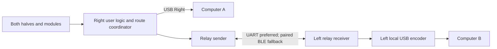

# UHK80 dual USB: implementation contract

Experimental firmware, disabled by default. The right and left USB ports are
independently selectable hosts; the right remains the keyboard controller.
The [development guide](uhk80-dual-usb-hosts-development.md) covers build, test and
runtime commands. The [PRD](uhk80-dual-usb-hosts-prd.md) defines release acceptance.
The cleaned feature has not been flashed; hardware acceptance remains pending.

## Architecture and code map

The right owns keymaps, layers, macros and host selection, and routes complete
keyboard, mouse and consumer/system reports to the selected USB host. Selection
gates input, while both USB interfaces and vendor commands remain available.
Descriptors, VID/PIDs, bootloader and saved configuration format are unchanged.

| Source | Ownership |
| --- | --- |
| `device/src/usb_left_relay_protocol.c/.h` | Byte codec, bounds, canonical reports and status codes. |
| `device/src/usb_left_relay.c/.h` | Handshake/session, retries, lease, deduplication and neutralization. |
| `device/src/usb_left_relay_uhk.c/.h` | Platform API, transport/generation selection, transmit worker, scheduler and RAM slot. |
| `device/src/host_route.c` | Drain/release/prepare/commit and fresh-input gating. |
| `right/src/hid/usb_left_adapter.cpp/.hpp`, `device/src/usb_left_transfer.h` | Local encoding, tickets/reservations, submitted-state snapshots and completion identity. |
| `right/src/hid/transport_usb.cpp` | USB-worker submission/cancellation and lifecycle fences. |
| `device/src/messenger*`, `nus_client.c`, `nus_server.c`, `bt_conn.c` | Explicit inter-half ingress/egress, NUS ownership/lifetime and selected-host radio profile. |
| `right/src/usb_report_sender.c`, `usb_report_updater.c`, `usb_semaphore.c`, macro code | Backpressure/baselines, physical-source suppression and output barriers. |
| `device/src/connections.c`, `right/src/host_connection.c`, `right/src/usb_state.c` | Aliases, availability, selection and local/remote USB state. |
| `device/Kconfig`, `device/CMakePresets.json`, relay/dev-slot overlays | Experimental relay on both halves; optional development slot on right. |

The main loop owns protocol/coordinator state and consumes completions. USB
submission/cancellation and lifecycle fences run on c2usb's worker. Reservations
remain owned until submission; buffer/ticket reuse requires proven drain.
Normal USB/BLE keyboard completion records the immutable submitted canonical
state even after timeout, keeping later key-up distinct from delivered key-down.

Relay transmission uses a four-packet queue and dedicated 2 KiB worker stack.
Packets own their connection and generation; stale traffic is discarded. Relay
NUS slot acquisition is nonblocking, legacy callers retain bounded wait, and
client payload survives asynchronous completion. Transient contention retries
for at most 32 ms with 2 ms yields and link rechecks.

## Protocol and transfer invariants

- Prefer UART bridge; fallback uses the existing paired/encrypted BLE NUS link
  with ATT MTU >=71. Notifications target the paired half. Selected-link reconnect
  or transport change requires fresh negotiation, drain and neutral delivery.
  Changes to unused BLE do not invalidate a healthy bridge route.
- Protocol version 1/schema `0x01DD041D` uses explicit byte codecs and a 64-byte
  relay packet bound. Canonical keyboard/mouse/controls sizes are 29/11/10 bytes.
  Left performs HID encoding for its local USB protocol and rollover.
- Peer identity, USB generation, selection and session token reject old traffic.
  BEGIN/END are idempotent; BEGIN succeeds after drain and neutral completions.
- One immutable pending report per kind. Retries retain bytes and sequence;
  DONE(success) requires matching successful USB completion, buffer identity and
  expected nonzero length. Failed/cancelled/stale callbacks cannot acknowledge
  delivery or advance another generation.
- In-flight duplicates do not resubmit. Completed duplicates resend cached DONE
  without repeating relative movement. Unknown USB outcomes fault and drain.
- Report retry/deadline is 32/128 ms, heartbeat 200 ms, lease 700 ms and state
  freshness 1,000 ms. Lease loss invalidates the token and clears reachable held
  state after drain. The poll event rearms after consumption. These timings are
  provisional; host regressions do not establish physical latency.

## Switching, suspension and configuration

A switch involving USB Left closes old output, drains transfers, sends old-host
all-up, prepares the new left session if needed, then commits. The 100 ms
macro/preparation barrier does not override an unproven drain: the transition
stays blocked. A suspended old USB host retains neutral-report debt for resume.
Held physical keys/modifiers/buttons, including the switch key, are suppressed
until release/fresh press. Layers and keymaps persist. `switchHost` is consumed
once and subsequent macro output waits at the barrier. Unavailable-route input
and relative deltas are discarded. Selected local USB-generation changes require
drain/all-up before reopening input.

Remote-left state distinguishes configured/suspended/wake permission/active/fault.
Missing or stale peer and unconfigured USB are unavailable; configured+suspended
is sleeping; negotiated configured+awake is ready. Ready is separate from active.
Host feedback applies only to the selected route. Resume needs fresh setup.
An awake selected wireless left host requests 7.5 ms/zero skipped events.

`CONFIG_UHK_USB_LEFT_RELAY` defaults off. Experimental presets enable both halves;
`CONFIG_UHK_USB_LEFT_DEV_SLOT` on right adds `USB_Left_Dev` in an empty regular
slot, reuses a unique existing left slot, and rejects duplicates/full capacity.
Reserved/paired slots and saved bytes are preserved. The RAM overlay returns
after successful configuration reload. Agent configuration/UI support is pending.

Feature tests cover protocol, routes, completions, scheduler and wireless/NUS
ownership. Builds check integration; physical transfer timing, separate-computer
isolation, handover, sleep/wake and the PRD soak/resource targets still need
hardware acceptance. The separate [baseline USB-C reconnect limitation](uhk80-dual-usb-hosts-development.md#known-baseline-limitation)
and its investigation history are recorded in the development guide.
